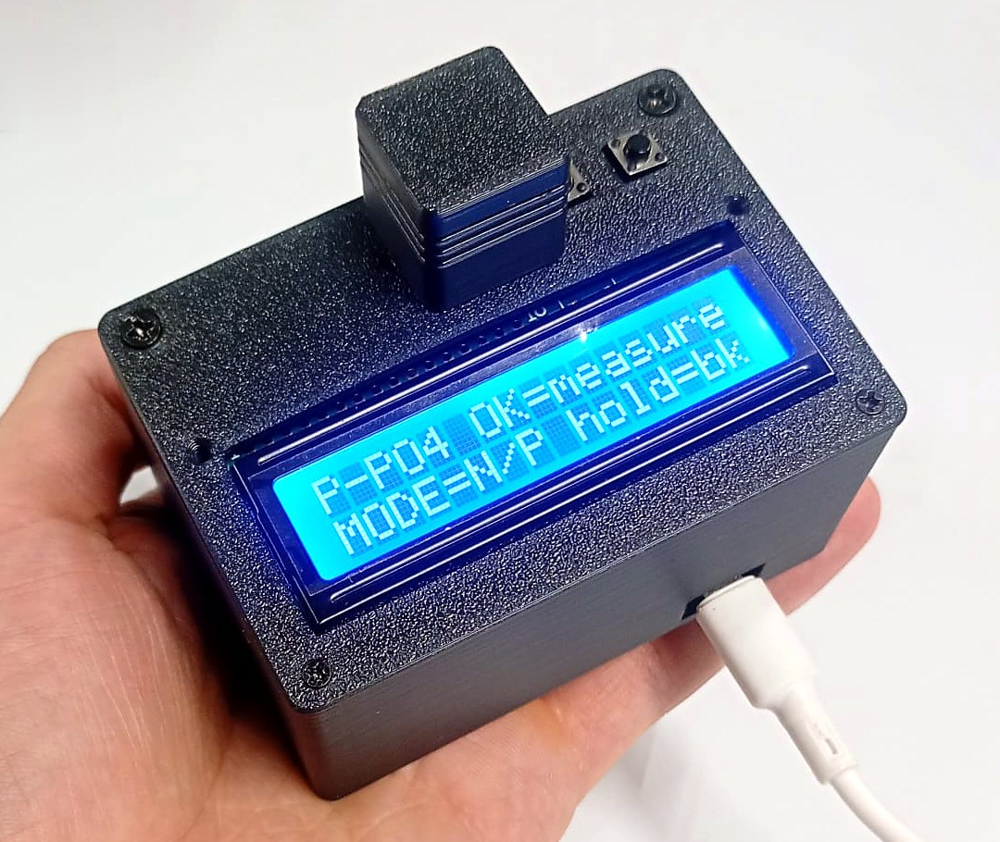
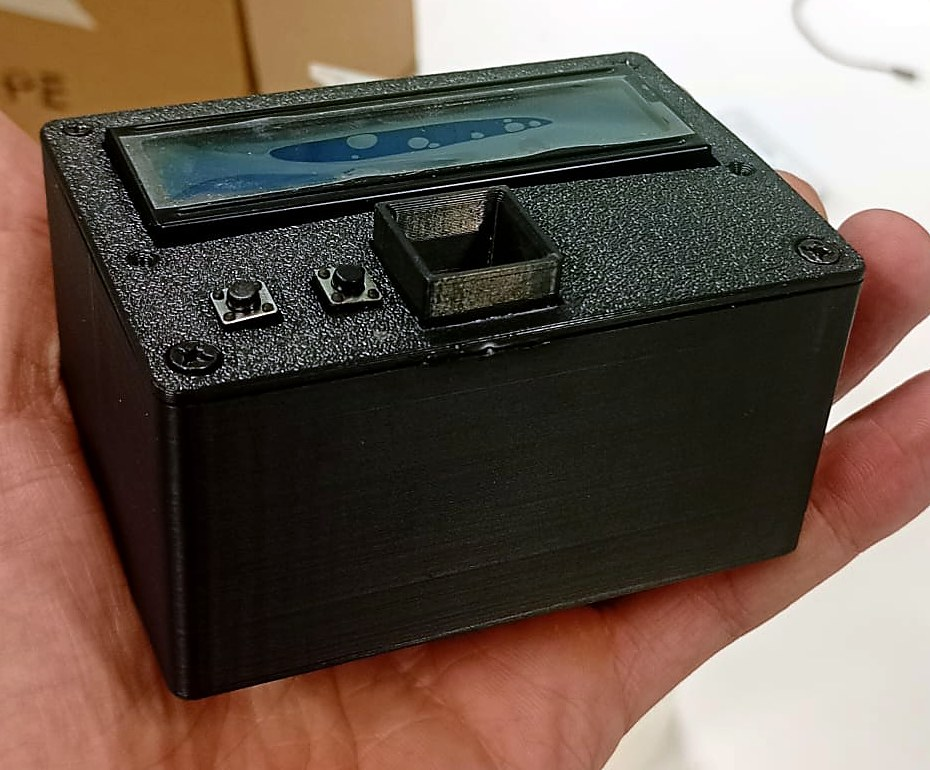

# PRATICO – low-cost colorimeter for nitrate and phosphate

PRATICO is an open-source, portable optical sensor that reads the colour of
FreshWater Watch nitrate (N‑NO₃) and phosphate (P‑PO₄)
kits and turns it into a concentration in mg/L. It is built from a Raspberry Pi Zero 2 W, an LTR‑329
light sensor, a green LED, a 16×2 LCD and a 3D-printed enclosure. It is designed for community
(citizen-science) freshwater monitoring.

  
  

<em>PRATICO 3: 85 × 60 × 44 mm, powered from a USB power bank.</em>

## Versions

| | PRATICO 2 | **PRATICO 3** (current) |
|---|---|---|
| Status | Published and field-tested (paper below), release [v2.0.0](https://github.com/LowCostSensor/PRATICO-sensor/releases) | Compact enclosure, new firmware, release v3.0.0 |
| Enclosure | 99 × 111 × 60 mm | 84.8 × 59.7 × 44 mm, about 57 % less plastic |
| Optics | LED and detector on prototyping boards, removable slit plate | Printed optical block: LED → 5 mm aperture → cuvette → aperture → LTR‑329 on one axis |
| Interface | 1 button | 2 buttons (OK, MODE) + LCD |
| Firmware | `legacy/pratico2/` | `firmware/` |

PRATICO 2 files are kept unchanged in [`legacy/pratico2/`](legacy/pratico2/). The exact files used in the
paper are also frozen in the v2.0.0 release.

## Getting started (PRATICO 3)

1. **Build it**: [docs/1-build.md](docs/1-build.md). Print the enclosure, mount the optics, wire the Pi.
2. **Set up the Raspberry Pi**: [docs/2-raspberry-setup.md](docs/2-raspberry-setup.md). OS, I²C, firmware (`pipx install pratico-sensor`), start at power-on.
3. **Calibrate**: [docs/3-calibration.md](docs/3-calibration.md). Standards, blanks, fit, quality checks.
4. **Measure in the field**: [docs/4-field-use.md](docs/4-field-use.md). Buttons, LCD messages, results file.

**Printable PDF guides** (A4, English):
[Build Guide](docs/pdf/PRATICO3_Build_Guide.pdf) (parts, printing, assembly, software, acceptance
test) and [User Guide](docs/pdf/PRATICO3_User_Guide.pdf) (field measurement, quality control,
calibration, data, maintenance, field data sheet). Sources in [`docs/pdf/src/`](docs/pdf/src/).

How the measurement works and why these settings were chosen:
[docs/5-measurement-protocol.md](docs/5-measurement-protocol.md).
Problems: [docs/troubleshooting.md](docs/troubleshooting.md).

## Repository map

| Folder | Content |
|---|---|
| [`firmware/`](firmware/) | PRATICO 3 software: field program, calibration, shared core, config, boot service |
| [`hardware/pratico3/`](hardware/pratico3/) | Enclosure CAD (STEP, STL, 3MF, parametric CadQuery script), bill of materials, wiring |
| [`hardware/datasheets/`](hardware/datasheets/) | Component datasheets |
| [`docs/`](docs/) | Build, setup, calibration and field guides; images |
| [`tools/`](tools/) | Hardware check scripts for a new build (buttons, LED, LCD, saturation sweep) |
| [`legacy/pratico2/`](legacy/pratico2/) | PRATICO 2 software, CAD and setup guide |

## Performance

Published for PRATICO 2 (Cirrone et al. 2025): calibration slopes 0.11 AU·L/mg (N‑NO₃) and
0.63 AU·L/mg (P‑PO₄); detection limits 0.05 mg/L N‑NO₃ and 0.003 mg/L P‑PO₄.

PRATICO 3 uses the same kits and the same measurement principle. Every instrument is calibrated
with its own standards ([docs/3-calibration.md](docs/3-calibration.md)). To validate a new instrument,
follow the validation procedure described in the paper.

## Citation

If you use PRATICO, please cite:

> Cirrone, R. G., Boldrini, A., Polvani, A., Arrigucci, M., Liu, X., Galgani, L., Woods, S., & Loiselle, S. A.
> (2025). Low-Cost Optical Sensing for Nitrate and Phosphate: Advancing Community Freshwater Monitoring.
> *ACS ES&T Water*, 5, 6258–6267. https://doi.org/10.1021/acsestwater.5c00314

GitHub shows the citation from [`CITATION.cff`](CITATION.cff) under "Cite this repository".

## About

The paper demonstrated PRATICO's analytical performance and reliability in the laboratory and in the
field, with all components integrated (technology readiness level 7–8). The same colorimetric kits
are used in more than 110 active citizen-science projects across Europe and Africa. Future work:
- fluorescence measurements;
- scattering correction;
- multispectral sensing;
- app-based functions;
- automatic online data sharing (coming soon).

## License

GNU General Public License v3.0. See [LICENSE](LICENSE).
<!-- TODO: decide whether hardware/ (CAD, BOM) should use CERN-OHL-S v2 instead; GPL-3.0 is kept for now. -->

## Contact

Riccardo Gaetano Cirrone – riccardogaetano.cirrone@unipa.it
