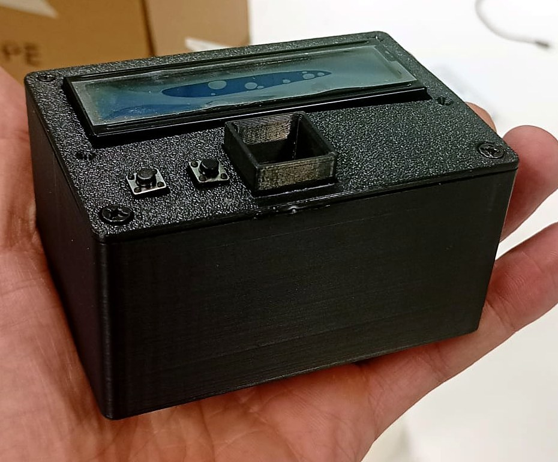
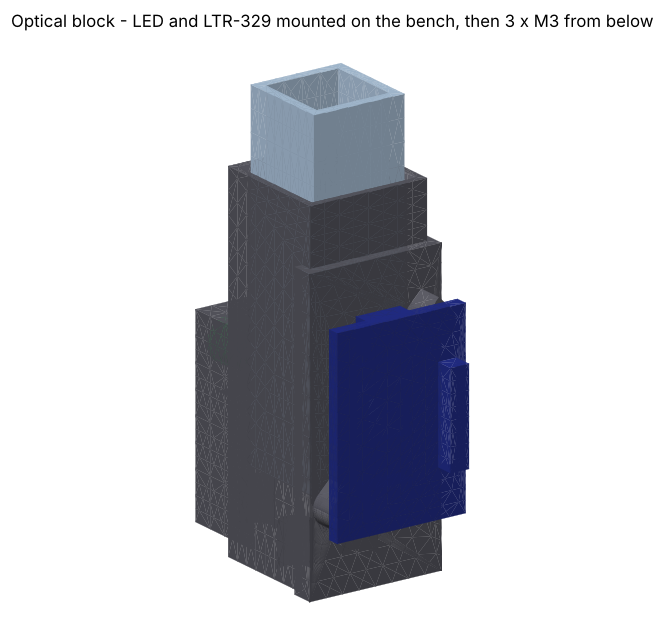

# 1 · Build PRATICO 3

Parts list, print settings and wiring table: [hardware/pratico3/README.md](../hardware/pratico3/README.md).

<p align="center">
  
  
</p>

## Assembly

1. **Print** all parts from `hardware/pratico3/cad/pratico3_plate_X1C.3mf` in black matte PLA, without
   supports.
2. **Check the cuvette fit** in the well before you mount anything. It must slide in without play.
3. **Heat-set inserts:** press the three M3 inserts into the base, at the optical block positions.
4. **LTR‑329:**
   1. Cut SJ1 on the back of the breakout.
   2. Solder the header.
   3. Screw the board to the optical block with 2 × M2 × 6, chip facing the aperture.
5. **LED:** push the 5 mm LED into its bore until the flange stops. Add a drop of glue if it is loose.
   Route the leads through the channel behind the holder.
6. **Optical block:** with the LED and sensor mounted on the bench, place the block in the base. Fix it
   from below with 3 × M3 countersunk screws.
7. **Pi Zero 2 W:** 4 × M2 × 5 onto the standoffs, header toward the optical block, ports toward the
   back wall.
8. **Buttons:** fit the two 6 × 6 switches in the lid. Seen from above with the LCD text upright,
   the left one is OK (GPIO 4) and the right one is MODE (GPIO 21). Wire each to its GPIO and to GND,
   using diagonal pins of the switch.

9. **LCD:** connect it (5 V, GND, GPIO 17, GPIO 27) and place it in the lid.
10. **Wiring:** follow the wiring table. Close the lid. <!-- TODO (author): lid fixing for the final revision -->

## First power-on check

After the software setup ([2-raspberry-setup.md](2-raspberry-setup.md)), with an empty or water-filled cuvette and
the lid closed:

```bash
i2cdetect -y 1          # 29 = LTR-329
i2cdetect -y 3          # 27 = LCD
python3 ~/PRATICO_3/firmware/pratico3_core.py   # self test: dark, LED level, % of full scale
python3 tools/gpio_test.py                      # buttons and LED (optional, from the repository folder)
```

What a working build looks like with a water-filled cuvette at 96×/200 ms:
- dark 0–3 counts;
- LED level about 30–40 % of full scale;
- CV of the conversions about 0.03 %.

Check these things:
- **Dark above 20 counts:** light is leaking in (lid, SJ1 LED, gaps).
- **LED level above 75 %:** lower the gain, or the integration time, in `pratico3_config.json`.
