# 1 · Build PRATICO 3 · Costruire PRATICO 3

Pictures first, words second. Every step has one line in English (EN) and one in Italian (IT).
Prima le figure, poi le parole. Ogni passo ha una riga in inglese (EN) e una in italiano (IT).

Parts list, print settings and wiring table · Distinta, stampa e collegamenti:
[hardware/pratico3/README.md](../hardware/pratico3/README.md).
Time · Tempo: about 1.5 h · circa 1,5 h.

## Parts · Componenti

<p align="center">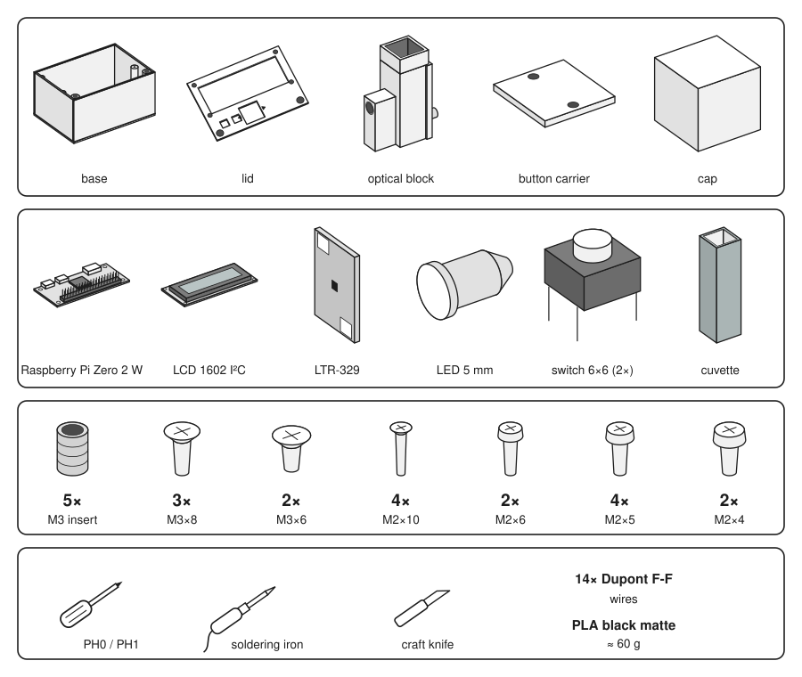</p>

| EN | IT |
|---|---|
| Print the five parts in **black matte PLA**, no supports (`hardware/pratico3/cad/pratico3_plate_X1C.3mf`). The inside of the box is part of the optics: black and matte only. | Stampa le cinque parti in **PLA nero opaco**, senza supporti (`hardware/pratico3/cad/pratico3_plate_X1C.3mf`). L'interno della scatola fa parte dell'ottica: solo nero e opaco. |
| Check that the cuvette slides into the optical block without play. Do not sand the well. | Verifica che la cuvetta entri nel blocco ottico senza gioco. Non carteggiare il pozzetto. |

## Inserts · Inserti

<p align="center">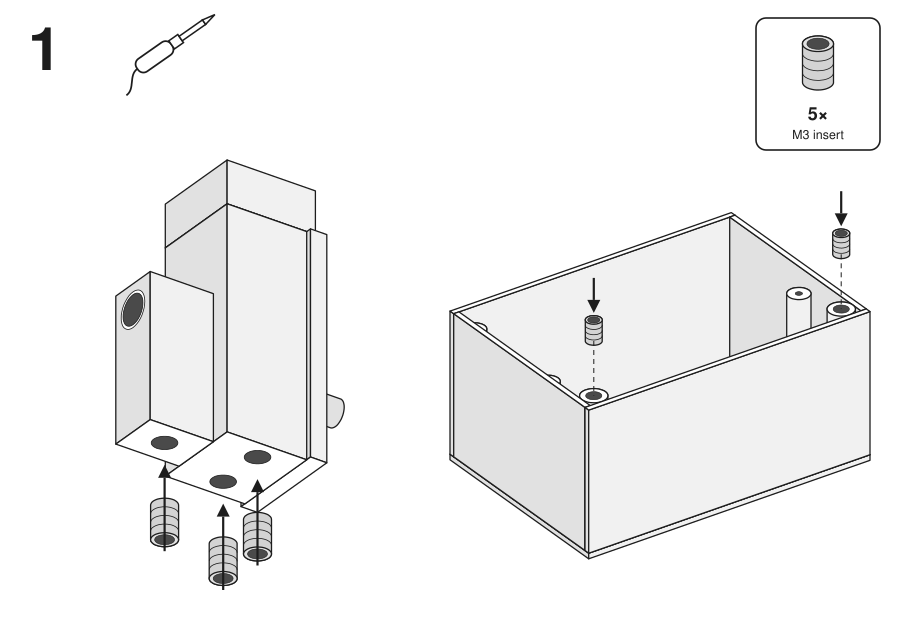</p>

| EN | IT |
|---|---|
| Soldering iron at about 200 °C. Press **3 inserts** into the bottom of the optical block and **2** into the front posts of the base, flush with the surface. | Saldatore a circa 200 °C. Inserisci a caldo **3 inserti** nel fondo del blocco ottico e **2** nelle colonnine anteriori della base, a filo con la superficie. |

## Sensor board · Scheda sensore

<p align="center">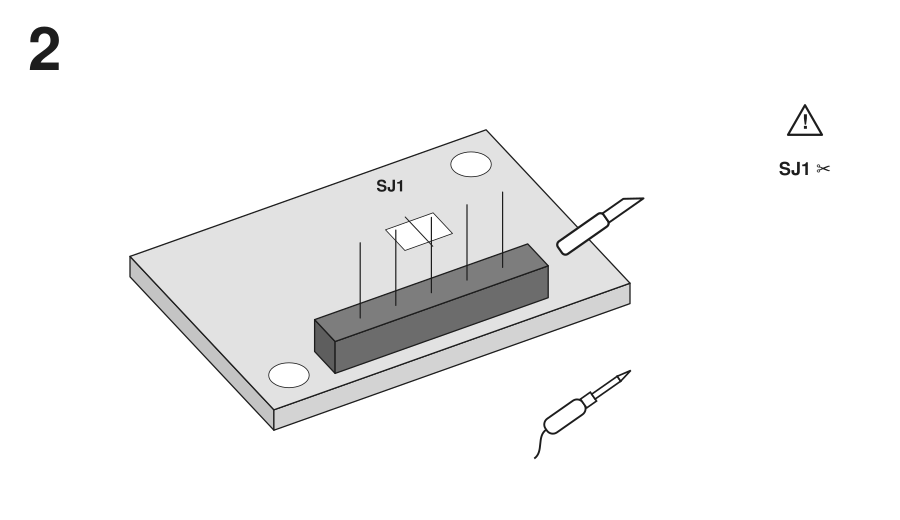</p>

| EN | IT |
|---|---|
| ⚠ **Cut SJ1** on the back of the LTR‑329 board. Otherwise its green power LED shines into the sensor. | ⚠ **Taglia SJ1** sul retro della scheda LTR‑329. Altrimenti il suo LED verde di alimentazione illumina il sensore. |
| Solder the 5‑pin header on the back. | Salda il connettore a 5 pin sul retro. |

## Sensor · Sensore

<p align="center">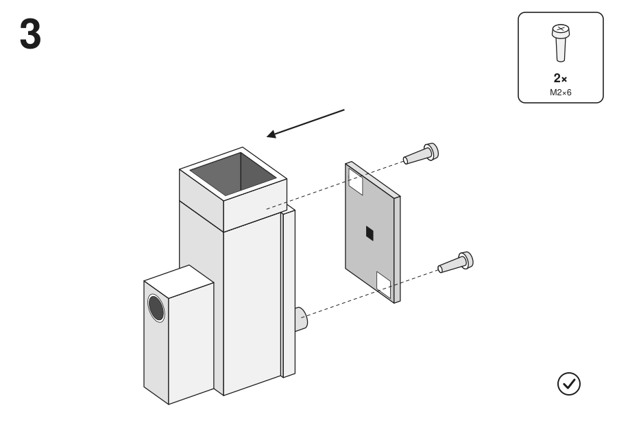</p>

| EN | IT |
|---|---|
| Sensor chip **facing the aperture**. 2 × M2×6. Do not overtighten. | Chip del sensore **rivolto verso la finestra**. 2 × M2×6. Non stringere troppo. |

## LED

<p align="center">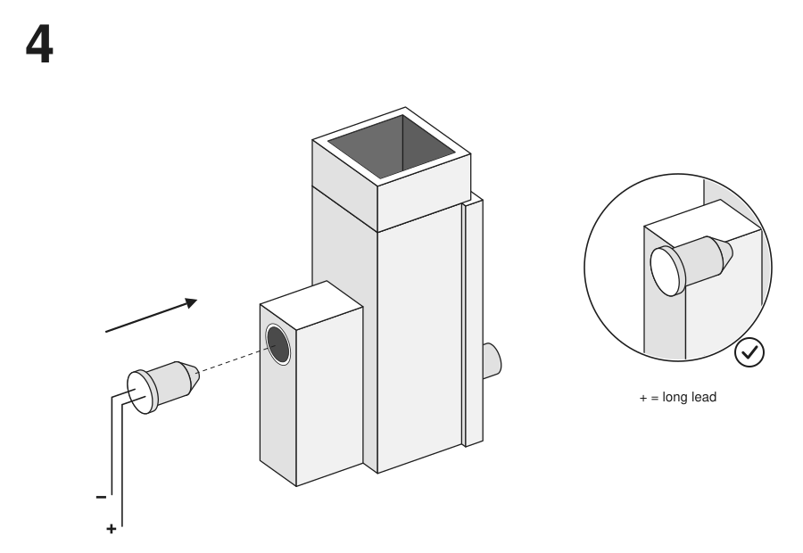</p>

| EN | IT |
|---|---|
| Push the LED into its bore until the **flange touches** the block. Bend the leads down. Long lead = **+**. | Spingi il LED nel foro fino a quando **la flangia tocca** il blocco. Piega i terminali verso il basso. Terminale lungo = **+**. |

## Optical block · Blocco ottico

<p align="center">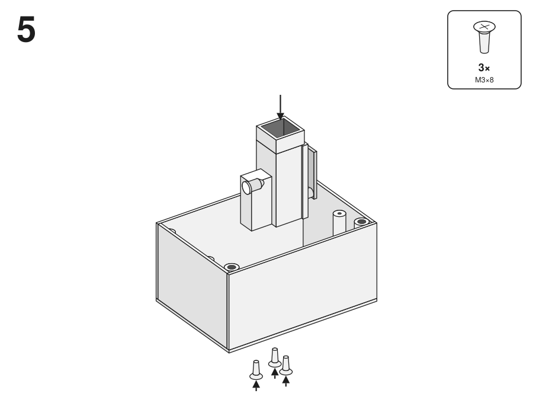</p>

| EN | IT |
|---|---|
| Set the block on the three pads in the base. Fix it **from below**: 3 × M3×8. | Appoggia il blocco sui tre piedini della base. Fissalo **da sotto**: 3 × M3×8. |

## Raspberry Pi

<p align="center">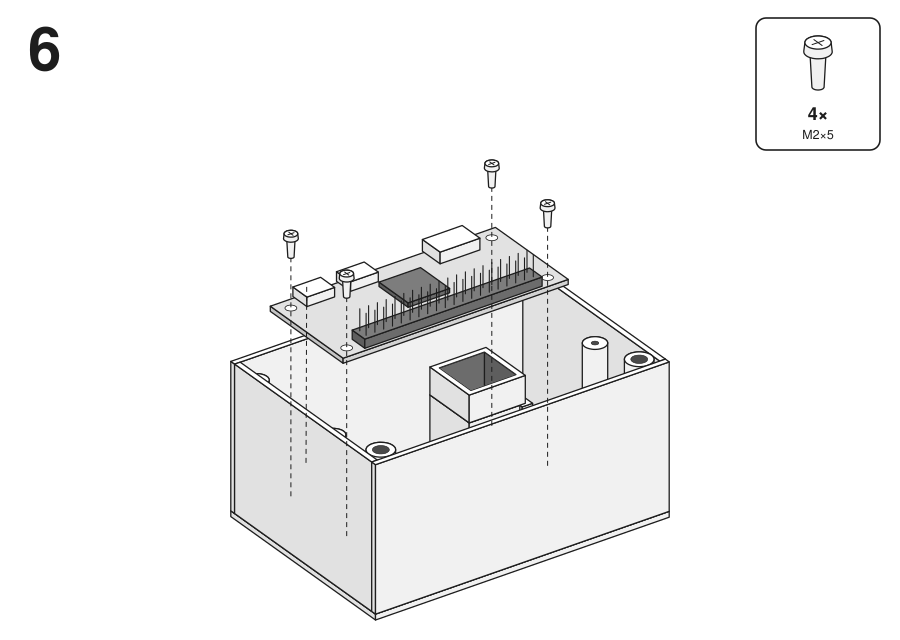</p>

| EN | IT |
|---|---|
| GPIO header toward the optical block, power port (PWR) at the opening in the back wall. 4 × M2×5. | Pettine GPIO verso il blocco ottico, porta di alimentazione (PWR) davanti all'apertura nella parete posteriore. 4 × M2×5. |

## Buttons · Pulsanti

<p align="center">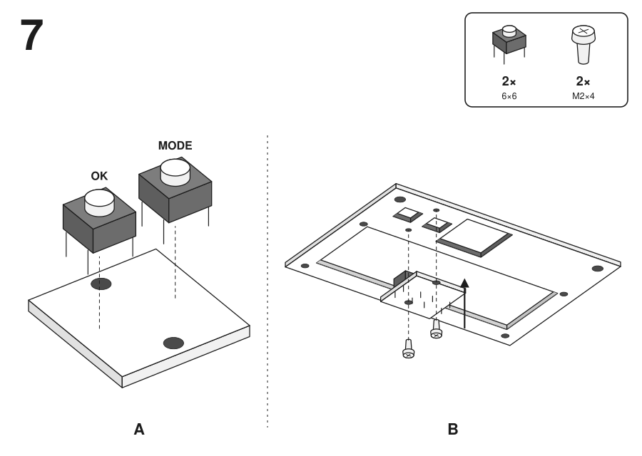</p>

| EN | IT |
|---|---|
| **A** · Seen from above: left switch = **OK**, right switch = **MODE**. Solder one wire to two **diagonal** pins of each switch. | **A** · Visti dall'alto: interruttore sinistro = **OK**, destro = **MODE**. Salda un filo a due piedini **in diagonale** di ogni interruttore. |
| **B** · Screw the carrier under the lid: 2 × M2×4. The switch tops come out flush with the lid. | **B** · Avvita il supporto sotto il coperchio: 2 × M2×4. Gli interruttori escono a filo del coperchio. |

## Wiring · Collegamenti

<p align="center">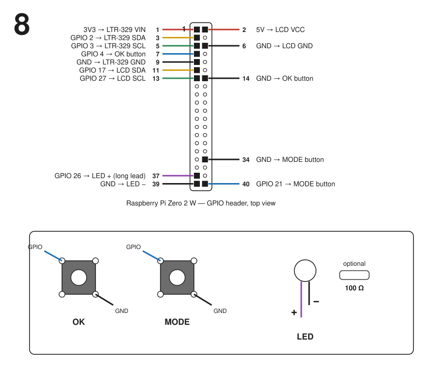</p>

| EN | IT |
|---|---|
| Female–female Dupont wires. Pin 1 is at the corner nearest the SD card. Any GND pin works. | Cavetti Dupont femmina–femmina. Il pin 1 è nell'angolo più vicino alla scheda SD. Va bene qualsiasi pin GND. |
| The LCD uses GPIO 17/27 (software I²C, set up in [2-raspberry-setup.md](2-raspberry-setup.md)), not the hardware I²C pins. | L'LCD usa GPIO 17/27 (I²C software, configurato in [2-raspberry-setup.md](2-raspberry-setup.md)), non i pin I²C hardware. |
| Optional: a 100 Ω resistor in series with the LED. | Facoltativo: una resistenza da 100 Ω in serie al LED. |

## Closing · Chiusura

<p align="center">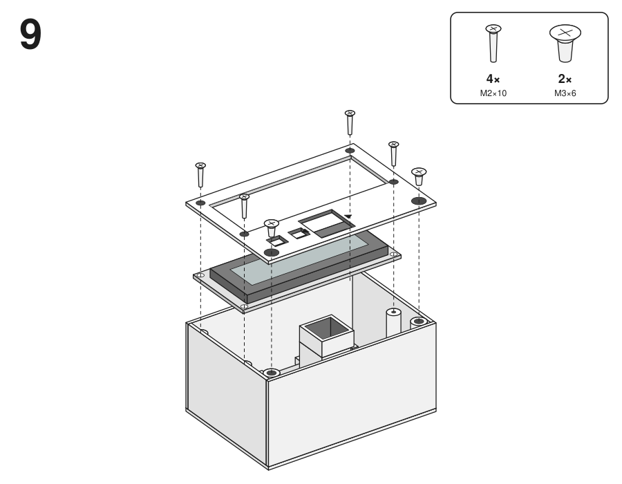</p>

| EN | IT |
|---|---|
| LCD on the four posts, display up. Lid on top: **4 × M2×10** through the LCD corners, **2 × M3×6** at the front. Keep the wires away from the light path. | LCD sulle quattro colonnine, display in alto. Coperchio sopra: **4 × M2×10** negli angoli dell'LCD, **2 × M3×6** davanti. Tieni i fili lontani dal percorso della luce. |

## Ready · Pronto

<p align="center">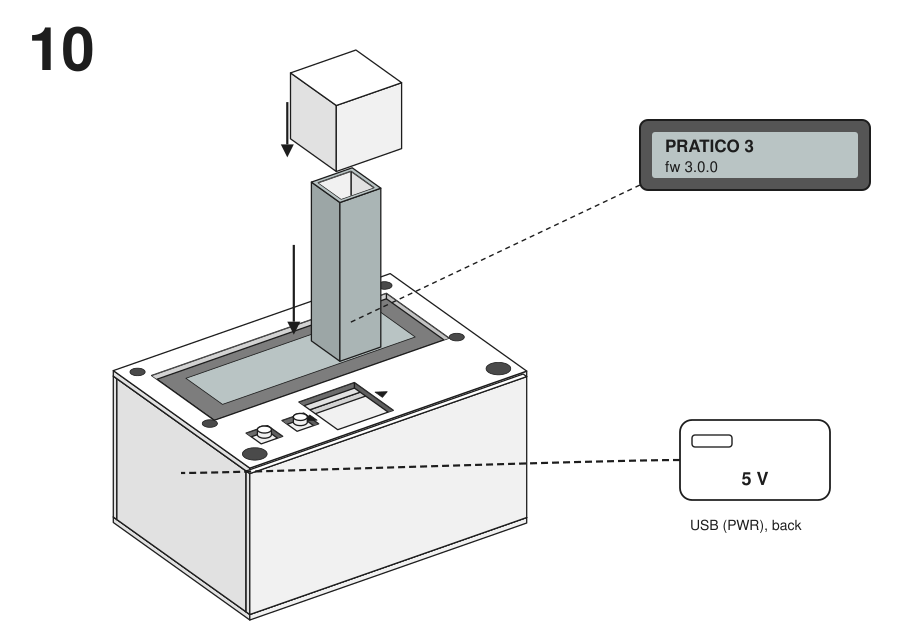</p>

| EN | IT |
|---|---|
| Cuvette in the well, cap on top. 5 V USB power bank into the PWR port at the back. After about a minute the LCD shows `PRATICO 3`. | Cuvetta nel pozzetto, tappo sopra. Power bank USB 5 V nella porta PWR sul retro. Dopo circa un minuto l'LCD mostra `PRATICO 3`. |

## First power-on check · Primo controllo

After the software setup ([2-raspberry-setup.md](2-raspberry-setup.md)), with a water-filled cuvette
and the cap on · Dopo l'installazione del software, con la cuvetta piena d'acqua e il tappo:

```bash
i2cdetect -y 1          # 29 = LTR-329
i2cdetect -y 3          # 27 = LCD
pratico-selftest        # self test / autotest
python3 tools/gpio_test.py   # buttons and LED / pulsanti e LED (optional, from the repository)
```

| What a good build shows (96× / 200 ms) | Cosa mostra uno strumento ben montato |
|---|---|
| Dark 0–3 counts | Buio 0–3 conteggi |
| LED level about 30–40 % of full scale | Livello LED circa 30–40 % del fondo scala |
| CV of the conversions about 0.03 % | CV delle conversioni circa 0,03 % |
| **Dark above 20 counts:** light leak (cap, SJ1 LED, gaps). | **Buio sopra 20 conteggi:** entra luce (tappo, LED SJ1, fessure). |
| **LED level above 75 %:** lower the gain or the integration time in `pratico3_config.json`. | **Livello LED sopra 75 %:** riduci il guadagno o il tempo di integrazione in `pratico3_config.json`. |

<sub>Drawings generated from the CAD dimensions by [`images/build/make_figures.py`](images/build/make_figures.py) ·
Disegni generati dalle dimensioni del CAD.</sub>
