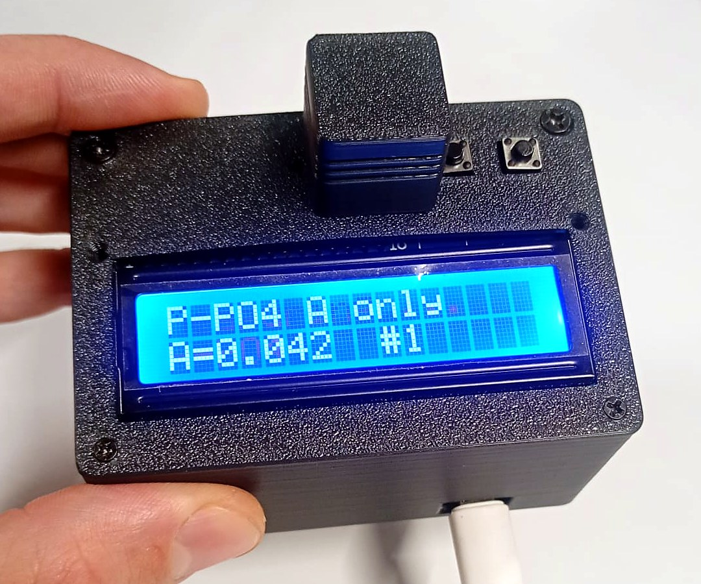

# 4 · Field use

No PC needed. Switch the instrument on (USB power bank). The field program starts by itself within
about a minute and shows `PRATICO 3`.

Buttons, seen with the LCD text upright: **OK** on the left, **MODE** on the right.

| Button | Short press | Hold 3 s |
|---|---|---|
| **OK** (left) | confirm / measure / start the timer | – |
| **MODE** (right) | switch N‑NO₃ ↔ P‑PO₄ / go back | new blank |

## Measuring

1. **Blank** (`Blank: DI water`):
   - Fill the cuvette with distilled water, close the lid, press **OK**.
   - `Blank OK 35% FS` means ready.
   - Take a new blank (hold MODE) if the instrument has been on for a long time or the temperature has
     changed a lot.
2. **Choose the analyte** (`N-NO3 OK=measure`): press **MODE** to switch to P‑PO₄.
3. **Sample:** follow the kit instructions to react the sample, then:
   - **No countdown configured:** insert the cuvette, close the lid, press **OK**.
   - **Countdown configured:**
     1. At `Add reagent, OK=start timer`, add the reagent and press **OK**.
     2. Insert the cuvette and close the lid while the countdown runs.
     3. The reading is taken automatically at 0.
4. **Result:** the LCD shows the result, for example `N 1.23 mg/L` on the first line and `A=0.132  #12`
   on the second. #12 is the sample number in the results file.
   - Write the number down with your field notes.
   - Press **OK** to measure the next sample.

You can switch the instrument off as soon as a result is displayed. Results are saved before they
are shown.

## LCD messages

| Message | Meaning | What to do |
|---|---|---|
| `N-NO3 <LOD` | below the detection limit of the calibration | report as < LOD |
| `N 12.3 mg/L!` / `over range` | above 1.1 × the highest calibration standard | dilute the sample and measure again |
| `A only` | no calibration on this instrument | calibrate ([3-calibration.md](3-calibration.md)) |
| `Light leak/lid` | dark signal too high | close the lid, keep the instrument out of direct sun, OK = retry |
| `Saturated` | too much light | check the cuvette, take a new blank |
| `No signal` | no light reaches the sensor | LED or cuvette problem, sample far too dark |
| `Unstable signal` | the reading changed during the measurement | bubbles, cuvette moving, colour still developing; OK = retry |
| `Blank low` | blank below 20 % of full scale | wrong blank (coloured?), dirty cuvette, LED problem |

## Results

On the instrument:
- `~/PRATICO_3/results/results.csv`: one row per sample. Columns include:
  - `seq`, `datetime`, `analyte`, `conc_mgL`, `flag`;
  - `A` (absorbance) and `sigma_A`;
  - `reaction_s`, the blank and sample counts and `blank_age_s`;
  - the setting, `cal_date` and the firmware version.
- `~/PRATICO_3/logs/YYYYMMDD.jsonl`: every reading with its raw conversions, for troubleshooting.

Copy the files with `scp`, or remove the SD card.

`clock_synced = 0` means the Pi had no network since power-on, so `datetime` may be wrong. The Pi Zero
has no real-time clock. Use `seq` and your field notes for the order and time of the samples.
