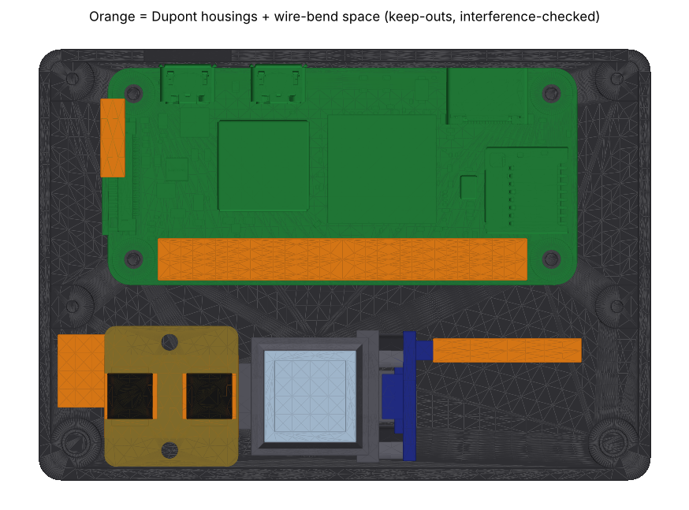

# PRATICO 3 – hardware

## CAD files (`cad/`)

| File | Content |
|---|---|
| `pratico3_plate_X1C.3mf` | All printable parts on one plate (Bambu Lab X1 Carbon), already oriented, no supports |
| `pratico3_assembly.step` | Full assembly with the Pi Zero 2 W and LCD models (for checking fit) |
| `pratico3_base.step`, `pratico3_lid.step` | Base and lid |
| `pratico3_optical_block.stl` | Optical block (cuvette well, LED bore, apertures, LTR‑329 mount) |
| `pratico3_enclosure.py` | Parametric CadQuery script that generates the parts (dimensions at the top of the file) |

<!-- TODO (author): the script and base/lid STEP are from revision 0.1, the optical block, plate and assembly from 0.2.
     Confirm they belong together, or export all parts again from the final script. -->

## Bill of materials

| Qty | Part | Notes |
|---|---|---|
| 1 | Raspberry Pi Zero 2 W | with a 2 × 20 male header |
| 1 | microSD card ≥ 8 GB | Raspberry Pi OS Lite (Debian 13 "trixie" tested) |
| 1 | 5 V micro-USB supply or USB power bank | power bank for field use |
| 1 | Adafruit LTR‑329 breakout | I²C, 0x29 |
| 1 | 5 mm LED, 525 nm (green) | |
| 1 | LCD 1602 with I²C backpack (PCF8574, 0x27) | e.g. Freenove I²C LCD 1602 |
| 2 | 6 × 6 mm tactile switch | OK and MODE |
| – | Female–female Dupont jumper wires | |
| 1 | Cuvette, 10 mm path (12.5 × 12.5 × 46 mm outer, 10 × 10 mm inner) | macro cuvette, 1.5–2 mL |
| 3 | M3 heat-set insert + M3 countersunk screw | optical block → base (from below) |
| 2 | M2 × 6 screw | LTR‑329 → optical block |
| 4 | M2 × 5 screw | Pi Zero 2 W → standoffs |
| – | Lid screws | <!-- TODO (author): type, length and number for the final lid --> to be confirmed |
| – | Black matte PLA, about 60 g | the inside of the box is part of the optics, so use black and matte |

Optional, recommended: an LED driver (NPN transistor such as BC547/2N2222 from 5 V, 100 Ω series and
1 kΩ base resistors) or at least a series resistor. Driven straight from a 3.3 V GPIO, the LED current
depends on the GPIO and on temperature.

## Printing

- Bambu Lab X1 Carbon, black matte PLA, 0.4 mm nozzle, 0.20 mm layers, 4 wall loops, 15 % gyroid
  infill, 5 top/bottom layers, no supports.
- **Cuvette well:** the cuvette must slide in without play (0.25 mm clearance per side). If it is
  tight, change the clearance parameter in the script and reprint. Don't sand the well: sanding makes
  it shiny.

## Wiring

| Signal | Raspberry Pi (BCM / physical pin) | Notes |
|---|---|---|
| LTR‑329 VIN, GND | 3V3 (pin 1), GND | 3Vo not connected |
| LTR‑329 SDA, SCL | GPIO 2 (pin 3), GPIO 3 (pin 5) | hardware I²C‑1 |
| LCD VCC, GND | 5V (pin 2), GND | |
| LCD SDA, SCL | GPIO 17 (pin 11), GPIO 27 (pin 13) | software I²C bus 3 (see setup) |
| LED anode, cathode | GPIO 26 (pin 37), GND (pin 39) | active high |
| OK button (left) | GPIO 4 (pin 7) ↔ GND | internal pull-up |
| MODE button (right) | GPIO 21 (pin 40) ↔ GND | internal pull-up |

Notes:
- **LTR‑329 power LED:** cut solder jumper SJ1 on the back of the breakout. Otherwise its green
  power LED can leak light into the aperture.
- **LCD pull-ups:** the PCF8574 backpack pulls SDA/SCL up to 5 V while GPIO 17/27 are 3.3 V pins. It
  works in practice, but a bidirectional level shifter removes the risk.

